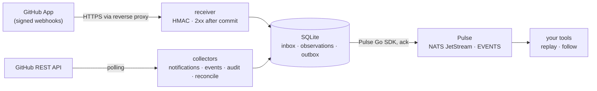

<p align="center">
  
</p>

<h1 align="center">pulse-github</h1>

<p align="center">
  <strong>Your GitHub activity, captured durably and replayable in Pulse.</strong><br>
  Signed webhooks, notifications, Events API feeds and reconciliation for every personal and organization account you
  monitor, published to <a href="https://github.com/aurimasniekis/go-pulse">Pulse</a> with stable event IDs.
</p>

<p align="center">
  <a href="https://aurimasniekis.github.io/go-pulse-github/">Documentation</a> ·
  <a href="https://aurimasniekis.github.io/go-pulse-github/guide/quick-start">Quick start</a> ·
  <a href="https://aurimasniekis.github.io/go-pulse-github/reference/coverage">Coverage</a> ·
  <a href="https://aurimasniekis.github.io/go-pulse-github/reference/event-contract">Event contract</a>
</p>

## Why

GitHub activity is scattered: webhooks for repositories an App is installed on, notifications for one user, an Events
API that forgets after 300 events or 30 days, an audit log only on Enterprise Cloud. None of them keeps history for
you, and a tool written next month starts with nothing.

pulse-github collects every one of those sources the configured credentials may read and publishes it into
[Pulse](https://aurimasniekis.github.io/go-pulse/), a durable event bus on NATS JetStream. Any tool can then replay
`evt.github.>` from a timestamp and follow it live, with its own least-privilege credentials.

## How it works



1. A **GitHub App** installed on your accounts sends signed webhooks. Each delivery is committed to SQLite before
   GitHub gets its 2xx, then normalized and routed to the configured account.
2. **Pollers** read notifications (classic PAT), Events API feeds and optionally the organization audit log, with
   conditional requests and GitHub's poll intervals. Data and checkpoints are committed together.
3. **Reconciliation** keeps installations and repository access current and takes bounded, resumable snapshots, for
   periodic checks and `backfill` after downtime.
4. A per-account **outbox** publishes through the Pulse Go SDK and marks each event done only after the JetStream
   acknowledgement. Pulse outages only queue events on disk.

**Key features**

- **Durable webhooks.** HMAC-verified with secret rotation, size and time limits, storage admission control and
  `X-GitHub-Delivery` deduplication. Unknown event types and actions are kept and published.
- **Every supported source.** Webhooks, notifications, Events API feeds (user, received, org, repository), the audit
  log, installation and repository-access reconciliation, snapshots of repositories, issues, pull requests, releases
  and workflow runs, and optional, budgeted enrichment.
- **At least once, with stable IDs.** Deterministic event IDs (`Nats-Msg-Id`) survive retries, restarts,
  redeliveries and quarantine replays; each account is published in order. Oversized documents go to a Pulse blob or
  to quarantine, never truncated.
- **Subjects made for replay.** `evt.github.<account>.<source>.<event>.<action>`, encoded collision-free and
  validated with Pulse's own subject rules.
- **Lossless and honest.** GitHub's JSON travels byte for byte next to normalized identifiers and provenance (live,
  snapshot, inferred). Coverage gaps and lost access become events and metrics.
- **Many accounts, explicit routing.** One process serves many personal and organization accounts; events are routed
  by verified installation or credential plus explicit shares, never guessed from actor logins.
- **Operable.** One static binary in a distroless, non-root, read-only image for linux/amd64 and linux/arm64. SQLite
  state, Prometheus metrics and alerts, JSON logs, a read-only `doctor`, `status`, `backfill`, quarantine tools and
  graceful shutdown.

What each source needs, and what nothing can see, is on the
[coverage](https://aurimasniekis.github.io/go-pulse-github/reference/coverage) page.

## Quick start

You need a running Pulse, a GitHub App installed on your accounts, and Docker.

```sh
# 1. A Pulse client that may only publish GitHub events
pulse clients create pulse-github --grant 'publish:evt.github.>' --out secrets/pulse_github.creds

# 2. GitHub credentials, one file each (owned by uid 65532, mode 0400)
#    secrets/github_app_key.pem, secrets/github_webhook_secret, secrets/github_pat_<login>

# 3. Configuration and Compose file
curl -fsSLO https://raw.githubusercontent.com/aurimasniekis/go-pulse-github/main/deploy/compose.yaml
curl -fsSL -o config.yaml https://raw.githubusercontent.com/aurimasniekis/go-pulse-github/main/deploy/config.example.yaml
$EDITOR config.yaml compose.yaml

# 4. Check, start, watch
docker compose run --rm pulse-github config validate --check-secrets
docker compose run --rm pulse-github doctor --test-publish
docker compose up -d
pulse sub 'evt.github.>' --since 1h
```

There is no published image yet: build it with `make image IMAGE=ghcr.io/aurimasniekis/pulse-github:latest`. The
[quick start](https://aurimasniekis.github.io/go-pulse-github/guide/quick-start) walks through every step, including
the GitHub App settings and a polling-only setup without inbound access.

## Events

```text
evt.github.example-org.webhook.pull_request.opened      ce-type github.webhook.pull_request.opened.v1
evt.github.octocat.notifications.thread.updated         ce-type github.notifications.thread.updated.v1
evt.github.octocat.activity.push.observed               ce-type github.activity.push.observed.v1
evt.github.example-org.reconcile.issue.changed          ce-type github.reconcile.issue.changed.v1
evt.github.octocat.collector.coverage.gap_detected      ce-type github.collector.coverage.gap_detected.v1
```

The body is a versioned JSON document with the account, actor, repository, resource, times, provenance and the
original GitHub payload. Consumers deduplicate by event ID. See the
[event contract](https://aurimasniekis.github.io/go-pulse-github/reference/event-contract) and
[consuming events](https://aurimasniekis.github.io/go-pulse-github/guide/consuming).

## Documentation

Everything is on the **[documentation website](https://aurimasniekis.github.io/go-pulse-github/)**:

- [Get started](https://aurimasniekis.github.io/go-pulse-github/guide/what-is-pulse-github): what it is, the quick
  start, the GitHub App and tokens, and consuming events.
- [Reference](https://aurimasniekis.github.io/go-pulse-github/reference/coverage): coverage, the event contract,
  configuration, commands, metrics and alerts.
- [Operator guides](https://aurimasniekis.github.io/go-pulse-github/operators/): deployment, backups, upgrades,
  credential rotation, capacity, troubleshooting and outage recovery.
- [Design](https://aurimasniekis.github.io/go-pulse-github/design/architecture): architecture and decision records.

## Development

```sh
make build        # bin/pulse-github (CGO_ENABLED=0)
make test         # go vet + race tests, including embedded JetStream with Pulse-equivalent least-privilege creds
make check        # gofmt, lint, tests, govulncheck, gitleaks
make e2e-pulse    # opt-in: real pulsed + NATS in Docker, client created through the Pulse admin API
make site-dev     # documentation website with live reload
```

The Pulse SDK requires Go 1.27.3. See [CONTRIBUTING.md](CONTRIBUTING.md).

## Status

Not released yet. Verified in this repository: unit and integration tests (including an embedded nats-server in
operator mode with Pulse v0.1.3's `EVENTS` configuration and permissions, and a webhook → SQLite → SDK → JetStream run
across a NATS outage), an end-to-end run against the real `pulsed` 0.1.3 image, and the image running read-only as
uid 65532. Not verified: live GitHub credentials (GitHub behaviour is tested against a fake server built from the
official documentation), GitHub Enterprise Server, and the audit-log query format.

## Security

pulse-github copies private GitHub content into Pulse; grant `subscribe` on `evt.github.>` only to tools that may read
it. Report vulnerabilities privately; see [SECURITY.md](SECURITY.md).

## License

[MIT](LICENSE)
